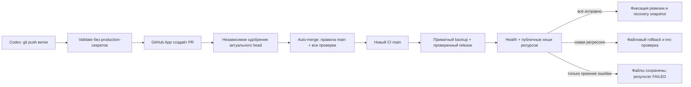

# NeuroDelo: автоматический CI/CD

> Актуальное состояние bootstrap, административные действия и реальные SpaceWeb blockers: [CICD-BOOTSTRAP-ISSUE-8.md](CICD-BOOTSTRAP-ISSUE-8.md). Этот отчёт заменяет устаревшие выводы о недоступности SSH, обязательном переносе secret scope и раннем включении READY.

> Актуальные результаты GitHub Actions, штатный GITHUB_TOKEN вместо обязательного App и подтверждённые блокировки: [AUTOMATION-VERIFICATION.md](AUTOMATION-VERIFICATION.md). Противоречащие этому отчёту сведения ниже описывают прежнее состояние.

## Что меняется

Владелец разрешил автоматическую публикацию **одобренных** обновлений. Эта версия заменяет прежний режим manual-only из Stage 2.1; старые отчёты описывают историческое состояние. Изменений публичного дизайна, PHP API или рабочих конфигураций в этом PR нет. Ветка основана на main со Stage 2.2, без неслитой модели Stage 3.



До одноразовой настройки, слияния и реального подтверждения эта схема — подготовленный код, **не доказательство работающей автоматической публикации**. GitHub API/Actions и состояние защиты среды нельзя считать проверенными по чтению YAML.

## Рутинный путь после настройки

1. Codex отправляет отдельную ветку. На push любой ветки и PR в main запускается `Validate`; публикации веток/черновиков нет.
2. Ubuntu 24.04, PHP 8.4 (pdo_mysql/mbstring), Node 22, Python 3.12, Apache 2.4, MySQL Docker 5.7.44. Python-зависимости зафиксированы в tests/requirements.txt; Playwright устанавливает свою версию Chromium. SQL-тесты создают только случайные loopback-БД neuro_test_*.
3. PHP/JS syntax, actionlint с зафиксированным SHA256, shell syntax, все unittest `test_*.py`, Node unit, реальный Apache, существующие миграции и новые migration-тесты при их появлении. Пропущенная зависимость/неисполняемый тест — ошибка, не успех. Production-секретов в этом job нет.
4. Строится immutable artifact из 14 явно разрешённых app-файлов; .htaccess включён. Есть revision SHA и хеш каждого файла. Нет setup.php, config.php, config.example.php, политики, тестов, дампов, ключей или произвольных production-only файлов. Список задаётся policy.json и защитой remote.php; расширяется только с review и тестами.
5. Доверенный workflow auto-merge с main обрабатывает успешный CI внутренней ветки: сверяет actual ref/SHA/workflow, создаёт PR через GitHub App, если PR ещё нет. draft/* и wip/* становятся draft PR. Не читает и не выполняет артефакты PR.
6. После независимого одобрения актуального head и успешных проверок App включает native auto-merge с `--match-head-commit`. Самоодобрение, старое одобрение, changes requested, failing/pending/skipped обязательный Validate и поддельный check другого App не принимаются. Validate привязан к GitHub Actions app_id=15368. Для тестового merge commit проверяются родители head/base. Конфликтующие/не готовые к требованиям main ветки требуют работы разработчика; ограничения не обходятся.
7. Нативное слияние под GitHub App вызывает новый push main и CI. Обычный GITHUB_TOKEN для слияния **не используется**: порождённый им push может не запускать другие workflows. Проверка после review, пришедшего позже CI, выполняется schedule каждые 5 минут (GitHub может задержать schedule), без дополнительных кнопок владельца.
8. Только deploy job для main получает production environment/secrets, только после Validate. Устаревшая main-ревизия пропускается до SSH. Один deployment на репозиторий одновременно, cancel-in-progress=false; дополнительно приватный server flock/state. Очередь Actions может заменить старый pending run более новым — это не FIFO, но старый SHA не может перезаписать уже более новый main.

Рутинному выпуску не нужны ZIP, SSH-команды, скриншоты, workflow_dispatch, флажок dry-run или ввод publish phrase. Одобрение PR остаётся проверкой исходного кода, а не повторным разрешением деплоя. Автослияние не обходит правила GitHub; если автором PR является сам единственный владелец, GitHub не принимает его self-review. Для обычного пути App создаёт PR, владелец может его независимо одобрить. Первую интеграцию проверяют/сливают по действующим правилам до запуска этого App.

## Одноразовая настройка (не выполнена этой средой)

Нужен доступ администратора GitHub к API. В текущей Codex-среде проверен **CONNECT proxy 403 для api.github.com**, это не ответ GitHub о правах владельца. Сетевое разрешение было запрошено и выдано на ход, однако доменная блокировка осталась. Нужен разрешённый доступ к api.github.com в настройках исходящего доступа/интеграции, а не пароль в чат. Git fetch/push через доступный Git-канал работают отдельно.

Скрипт `python scripts/github/control.py bootstrap` показывает план без изменений. После административной авторизации через существующий безопасный gh login/GH_TOKEN: `python scripts/github/control.py bootstrap --apply`. Он не читает/не перезаписывает значения секретов и не подключается к SpaceWeb. При отсутствии нужных метаданных останавливается с AUTOMATION_READY=false, не притворяется настроенным.

Скрипт настраивает:

- main: обязательный успешный `Validate` от GitHub Actions, strict/up-to-date, минимум одно независимое review актуального изменения, dismiss stale, enforce admins, запрет force-push/удаления, разрешение обсуждений. Существующие более строгие checks/count/linear-history/push restrictions сохраняются; review bypass allowances очищаются. Существующие required deployments не отключаются; несовместимые организационные правила могут потребовать отдельного решения.
- Environment **production**: deployment branches только main; без повторного ручного approval/timer, поскольку разрешение даётся review main. Secrets **SSH_HOST, SSH_PORT, SSH_USER, DEPLOY_PATH, SSH_PRIVATE_KEY, SSH_KNOWN_HOSTS** хранятся здесь. DEPLOY_PATH строго `/home/n/neurodepro/public_html`. Existing known_hosts используется с StrictHostKeyChecking=yes, ssh-keyscan/автопринятия нет.
- Environment **automation**: только main, secret **AUTOMERGE_APP_PRIVATE_KEY**. Это не production SSH-ключ.
- GitHub App, установленный только на данный репозиторий: Contents write, Pull requests write, Administration read, Checks read, Actions read; Metadata read автоматически. Webhook не требуется. App ID — repository variable **AUTOMERGE_APP_ID**. Токен краткоживущий, выпускается/отзывается create-github-app-token, приватный ключ не хранится в Git.
- Repository allow_auto_merge=true, затем **AUTOMERGE_ENABLED=true** и **AUTOMATION_READY=true** только после проверки защиты и наличия metadata секретов. Старый DEPLOY_ENABLED больше не управляет рутинной публикацией. **DEPLOY_PAUSED=true** — аварийная пауза публикации, не рутинный approval; preview/rollback остаются maintenance-операциями.

GitHub не отдаёт значения существующих secrets обратно через API. Если SSH_PRIVATE_KEY сейчас repository-scoped, владелец должен один раз перенести тот же действующий ключ в production environment безопасно через GitHub, проверить корректность переноса и убрать старую repository-scoped копию. Скрипт ничего не удаляет из secrets и не может скопировать зашифрованное значение, которое API не раскрывает. Остальные production secrets также нужны в production environment. **Не отправлять пароли/ключи в чат.** Если уже есть подходящий GitHub App, повторно создавать его не нужно. Иначе однократно создать в https://github.com/settings/apps/new, установить на репозиторий и положить его ключ в environment automation.

Ссылки настроек:
- https://github.com/2006minden-gif/-Chat-GPT-/settings/branches
- https://github.com/2006minden-gif/-Chat-GPT-/settings/environments
- https://github.com/2006minden-gif/-Chat-GPT-/settings/variables/actions
- https://github.com/2006minden-gif/-Chat-GPT-/settings

План GitHub должен поддерживать выбранную защиту веток/environments. Видимость репозитория, существующие rules/secrets/App и права API в этом ходе не подтверждены: metadata API недоступен. Ни видимость, ни настройки владельца автоматически не менялись.

## Публикация на SpaceWeb

Серверу нужны CLI PHP 8.4 (при необходимости repository variable PHP_CLI с именем/путём бинарника), PDO MySQL, mbstring, proc_open, flock, rsync, writable public_html/private, достаточное место. Для одобренной новой миграции дополнительно совместимый mysqldump и DDL-права оператора. Наличие этих свойств на SpaceWeb не выдается за подтверждённое этим PR; user сообщил успешный прежний SSH dry-run, новый агент ещё там не запускался.

Проверка до записи: HTTPS baseline и private CLI preflight (без новых таблиц/данных): реальные конфиг/PDO/столбцы baseline, наличие владельца как булево, флаг политики как булево. Ошибки — тип, basename/строка, фиксированный код; без паролей, сырых PDO сообщений или SQL. Разрешённый app_url — https://neurodelo.pro. Читается существующий private/config.php, он не загружается с CI.

Служебное дерево вне public_html:

```text
/home/n/neurodepro/
  public_html/                 # только allowlisted приложение; uploads/cgi-bin сохраняются
  private/config.php           # никогда не перезаписывается
  private/privacy-policy.txt   # сохраняется без изменения
  .neurodelo-deploy/            # 0700, не веб-каталог
    lock
    state.json                 # pending, last result/revision/recovery pointers
    incoming/<timestamp-run-sha>/  # проверенный candidate, CLI agent, evidence
    backups/<release-id>/
      backup.json              # контрольные суммы прежних/новых файлов
      files/public_html/...    # прежний код, файлы 0600
      files/private/...        # без config/политики
      database.sql             # только перед одобренной новой миграцией
      database.json
    backups/good-<release-id>/  # health-verified снимок текущего кода
```

rsync передаёт immutable candidate в приватный staging; prod-файлы затем заменяются через временный файл и rename в том же каталоге. Временные имена начинаются с точки и заканчиваются .tmp, закрыты Apache-правилами. Это **атомарность отдельного файла, не всего сайта**: последовательная смена нескольких файлов может иметь краткое промежуточное состояние. Зависимые изменения должны сохранять совместимость; health/rollback ловят постусловия. Символические ссылки/неожиданные файлы/битые хеши/коллизии staging отвергаются. Нет --delete, удаления uploads/cgi-bin, массового rsync приватного каталога или автоматического удаления setup.php.

До первой замены — timestamped приватный backup существующих **управляемых app-файлов**, не всего аккаунта/пользовательских uploads. Конфиг/документ не копируются в release и остаются на месте; hashes проверяют отсутствие изменений. Server-only файлы никогда не входят в allowlist. Снимок полного аккаунта/внешнее хранение — задача отдельного резервирования, этот код не заявляет backup всех uploads.

После health успеха создаётся отдельный проверенный good snapshot. Retention сохраняет 3 последних завершённых снимка и дополнительно pinned latest known-good, active/last release и последний pre-migration DB backup. Поэтому защищённых копий может быть больше трёх. Удаляются только старые управляемые backup/candidate внутри служебного пространства; recovery point не удаляется ради quota. Политика места fail-closed: перед backup проверяется свободное место; при нехватке job падает до подмены. Неполные, ещё не отмеченные завершёнными служебные копии автоматически не уничтожаются — их разбирают при редком recovery, не смешивают с пользовательскими файлами. Лимит 1 ГБ не позволяет обещать бесконечную историю SQL-снимков; latest DB recovery pin сохраняется, внешняя архивная политика отдельна.

## Health и rollback

17 read-only HTTP проверок: главная, studio, privacy API/страница, анонимные session/leads, 6 запрещённых путей и 5 CSS/JS. Нет входа с owner-паролем или тестовых лидов на production. TLS проверяется; redirects/неожиданный HTML/JSON/слишком большой ответ не выдаются за успех. Публичные CSS/JS SHA256 должны совпасть с approved artifact: это дополнительно проверяет domain/docroot и обновление обслуживаемых ресурсов. Тела ответов не попадают в evidence, только статусы/классификация/request IDs/публичные hashes.

Неутверждённая политика: API 200 enabled=false + понятная HTML privacy.php 503 с закрытым приёмом — корректный fail-closed. Неожиданный backend JSON 503 — ошибка. Флаг политики, текст, setup_key и пароль не меняются ради зелёного health.

Новая регрессия или неудачная файловая операция вызывает rollback текущей попытки. Сначала проверяются все backup hashes/весь набор конфликтов; затем восстанавливается прежний код. Файл, которого не было, удаляется только если он точно создан этим release и содержит ожидаемые bytes. Неизвестные server-only файлы не удаляются. Посторонняя ручная правка блокирует rollback вместо её затирания. Credentials/DB/политика сохраняются, включая независимую ротацию конфигурации.

Rollback подтверждается только после совпадения всех файлов и повторного HTTP baseline (включая публичные hashes). Если baseline уже был нездоров, восстановление к нему не означает исправление сайта: исходный deployment остаётся FAILED. При SSH outage/неподтверждённой проверке результат rollback UNVERIFIED, есть backup/pending state; нельзя писать «успешно откатили». Хост/server lock и pending state не допускают слепого перекрытия незавершённого release.

Если после обновления остались только **те же** прежние провалы и новых регрессий нет, полезные approved исправления сохраняются (в частности, закрытие backup URL не отменяется из-за независимого старого 503). Результат всё равно FAILED / unhealthy_preexisting, latest known-good не продвигается, факт сохранённых файлов отражён в evidence. Изменение формы ошибки/новый провал не маскируются под прежнюю неисправность: требуется rollback.

Maintenance через workflow_dispatch после настройки: preview (по умолчанию, только read-only preflight/health и rsync --dry-run; нет staging/backup/prod write), rollback (восстановление active/last release с проверкой) либо deploy. Это восстановление/диагностика, **не обязательные ручные шаги обычного выпуска**. При остановленном процессе pending state требует recovery, чтобы не рисковать неизвестным промежуточным состоянием. Actions concurrency не отменяет действующий deploy при новом push.

## Миграции Stage 3

policy.json migrations сейчас **пуст**. Stage 3 не слит и не одобрен как production-миграция; его файлы сюда не переносились и SQL автоматически не запускается. Схема baseline/001–003 проверяется прежним suite на MySQL 5.7; при появлении новой up/down папки CI требует CLI и migration/full-regression tests, иначе падает.

Позже reviewed PR может добавить entry:

```json
{
  "version": "004_crm_foundation",
  "kind": "additive",
  "automatic": true,
  "required": true,
  "up_sha256": "REPLACE_WITH_REVIEWED_64_HEX_SHA256",
  "down_sha256": "REPLACE_WITH_REVIEWED_64_HEX_SHA256"
}
```

Это **пример, не действующее разрешение**. Hash заменяется реальным только в одобренном PR, с реальным runner/tests. Автоматика 004 допускает только 12 CREATE TABLE InnoDB, никаких ALTER/DROP/DELETE/UPDATE данных или arbitrary SQL. Backend после migration должен оставаться совместим со старой версией для файлового отката. На сервере сверяются policy hashes, migration journal/state и после CLI — подтверждённое applied с теми же checksums, а не только exit 0.

Перед изменением DB — реальный consistent mysqldump single-transaction в приватный 0600 файл, проверка ненулевого размера и SHA256. Настройки клиента временно читаются из production config в .cnf 0600, не argv/env/CI-log; файл удаляется finally. Client capability detection отключает column statistics для MySQL 8 client против 5.7 и GTID purge при поддержке. Snapshot не автоматически импортируется. Для не-InnoDB таблиц single-transaction не гарантирует consistency; текущая baseline/004 InnoDB, и дополнительные engines требуют отдельного backup-плана до разрешения.

Только после dump работает guarded Stage 3 up CLI; его version history/advisory lock/partial DDL semantics сохраняются. SQL backup остаётся pinned даже при последующем сбое, данные не затираются тестовыми fixtures. DDL implicit commits MySQL 5.7 означают, что файловый rollback **не откатывает базу**. Неполная migration state блокирует следующие попытки; не запускать down/import автоматически. Для восстановления DB нужны отдельное одобрение, остановка записи/согласование восстановления после snapshot и проверка в новой изолированной БД прежде переноса данных. Иначе можно потерять обращения, пришедшие после backup.

Для `automatic=false, required=true` отсутствующая миграция выдаёт manual_migration_approval_required. Разрушительные/необратимые SQL не имеют автоматического исполнителя: нужны отдельное явное одобрение и reviewed maintenance-план/оператор, backup/restore тест и окно обслуживания. Этот PR не предоставляет «force» или опасный обход под видом approval. Будущие версии кроме 004 требуют явного расширения оператора и тестов, не исполняются универсальным shell SQL.

## Доказательство полного пути после разблокировки

После одноразовой настройки/первого review отправить контролируемое reviewed изменение документации или самой конфигурации CI без изменения продукта. GitHub должен показать: Validate successful → App PR/review/merge → новый Validate main → Publish approved main → evidence result=deployed_and_verified, remote revision/files_verified, 17 HTTP checks + asset hashes, production environment deployment result. Это тест настоящего пути без непроверенной косметической подмены сайта. Сама отправка YAML и локальные зелёные тесты такого доказательства не дают.

Текущее фактическое состояние и blockers — в CICD-REPORT.md. До реального end-to-end допускается только вердикт **AUTOMATIC DEPLOYMENT NOT YET VERIFIED**.
