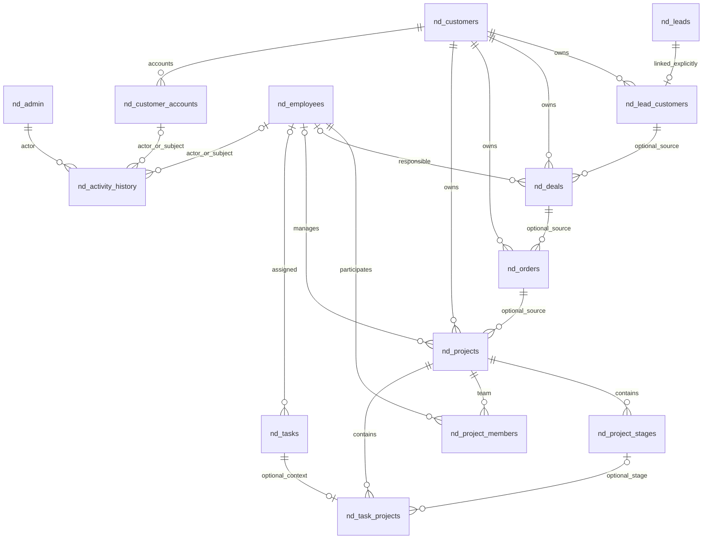

# Stage 3 — архитектура и модель данных NeuroDelo

## Границы

PHP 8.4/PDO, MySQL 5.7, HTML/CSS/JS сохраняются. Это только добавочная основа данных: публичный сайт и текущая CRM по-прежнему используют nd_leads/nd_admin/nd_sessions/nd_limits. Клиентский кабинет, регистрация, сотрудники как пользователи, новые CRUD/API и автоматический журнал операций **не реализованы**. Создание таблиц не предоставляет доступ к ним.

Базовая database/schema.sql остаётся схемой существующего сайта. Для расширенной CRM применяется **004_crm_foundation**, после базовой схемы либо после существующих 001–003 на старой установке. Не применять 001–003 повторно к свежему schema.sql. Не изменять ранее применённые файлы: следующий этап получает новый номер.

Миграция 004 создаёт 12 пустых InnoDB-таблиц и журнал версии. Она не выполняет ALTER/UPDATE/DELETE существующих таблиц, не копирует контакты, не создаёт пользователей и не меняет пароль владельца. Связь лида с клиентом создаётся только явной будущей командой владельца. Контакты клиентов не уникальны: совпадение email/телефона не означает автоматическое объединение обращений.

## Сущности и связи



В диаграмме source у сделки/заказа/проекта опционален; владелец customer обязателен. Все бизнес-сущности, включая лид/этап/задачу, также могут быть контекстом activity_history через отдельные внешние ключи (для читаемости не все линии показаны).

| Таблица | Назначение, ключевые ограничения |
|---|---|
| nd_customers | Физлицо/компания, имя и необязательные контакты; клиент не равен учётной записи |
| nd_lead_customers | lead_id PK: лид связан максимум с одним клиентом, клиент имеет много лидов; оригинальный лид остаётся неизменным |
| nd_deals | Несколько переговоров/сделок на клиента; необязательный источник lead и ответственный сотрудник |
| nd_orders | Согласованный заказ с уникальным номером и DECIMAL(15,2) UNSIGNED; необязательная сделка, несколько заказов на сделку допустимы |
| nd_projects | Исполнение работ для клиента; необязательный заказ и менеджер; заказ может иметь несколько проектов |
| nd_project_stages | Этапы проекта, уникальная position в проекте; позиция не обязана быть непрерывной |
| nd_tasks | Отдельные задачи, необязательный исполнитель, приоритет и срок; возможны внутренние задачи без проекта |
| nd_task_projects | task_id PK: задача относится максимум к одному проекту и необязательному этапу именно этого проекта |
| nd_project_members | M:N проект/сотрудник, без дублей пары; role описывает участие, **не является действующей авторизацией** |
| nd_employees | Карточка сотрудника, уникальный email; не содержит пароля и не даёт вход в owner CRM |
| nd_customer_accounts | Несколько учётных записей на клиента; email уникален, invited по умолчанию, nullable password_hash для будущего приглашения; токены и сессии здесь не создаются |
| nd_activity_history | Время, action и краткая summary; actor_admin/employee/customer_account и контексты со строгими FK; никаких паролей, токенов, полных запросов или автоматического копирования PII |

## Что гарантирует БД

- Числовые FK соответствуют типам родителей: существующие lead INT UNSIGNED и admin TINYINT UNSIGNED, новые ID BIGINT UNSIGNED. Все новые таблицы InnoDB/utf8mb4_unicode_ci.
- Составной FK сделки (customer_id,lead_id) требует явной связи этого лида с тем же клиентом. Составные FK заказа/сделки и проекта/заказа исключают смешение клиентов. NULL источника разрешает самостоятельный заказ/проект.
- Отдельная nd_task_projects с NOT NULL project_id и составным FK (project_id,stage_id) исключает этап чужого проекта и обход проверки через NULL project_id. Самостоятельная задача допустима без этой связки.
- UNIQUE защищает email сотрудника/аккаунта, номер заказа, position этапа, членство, единственную связь лида/задачи. FK ON DELETE RESTRICT; нет каскадного удаления данных и отключения FOREIGN_KEY_CHECKS.
- ENUM ограничивает набор состояний, UNSIGNED — отрицательные значения **в строгом SQL mode**. CLI требует STRICT_TRANS_TABLES или STRICT_ALL_TABLES. На CHECK MySQL 5.7 не полагаемся: он его не исполняет.
- Версия version существует у изменяемых сущностей; она не увеличивается магически — будущий write-service обязан использовать UPDATE WHERE id=? AND version=? с version=version+1 и проверять rowCount. Связующие таблицы меняются транзакционно.
- UTC: CLI устанавливает session time_zone='+00:00'; created_at/updated_at — DATETIME. Будущие соединения приложения также обязаны устанавливать UTC, иначе CURRENT_TIMESTAMP зависит от сессии.

## Жизненные циклы (контракт будущего сервиса)

| Сущность | Переходы |
|---|---|
| Клиент | active → archived; восстановление только явной командой владельца |
| Сотрудник | invited → active → suspended; active/suspended → archived; восстановление явно |
| Аккаунт клиента | invited → active → disabled; возврат active только после проверки доступа |
| Сделка | new → qualified → proposal → negotiation → won/lost; переход в lost возможен раньше; reopening только явно и с событием |
| Заказ | draft → confirmed → in_progress → completed; cancel до completed, с записью причины в событии |
| Проект | planned → active ↔ on_hold → completed/cancelled; отмена возможна из planned/active/on_hold |
| Этап | planned → active → completed; planned/active → cancelled |
| Задача | todo → in_progress ↔ blocked → done/cancelled; явное reopening в todo с историей |

**ENUM исполняет только допустимость значения, не граф переходов.** Переходы, синхронизация completed_at/closed_at/archived_at, проверка диапазона дат, непустого имени, ISO-кода валюты, нормализация email, принадлежность менеджера команде и запрет новых работ для архивного клиента должны быть реализованы и протестированы в будущем сервисном слое до открытия write API. В этой стадии API отсутствует, поэтому эти гарантии не выдаются за уже работающие функции.

Для active customer account будущий сервис требует установленный безопасный password_hash либо отдельно спроектированную внешнюю аутентификацию, подтверждённое приглашение/регистрацию и разрешённый сбор данных. Nullable hash/поле status сами по себе не авторизуют пользователя. Старый nd_sessions остаётся **только** сессиями владельца; его нельзя использовать для новых аккаунтов. Employee auth/RBAC и customer sessions проектируются отдельной миграцией, без переиспользования парольной записи nd_admin.

История — append-only на уровне будущего сервиса/прав runtime-пользователя; триггеров или готового запрета UPDATE/DELETE для прямого DBA-доступа здесь нет. Допускается system event без actor, иначе будущий сервис требует ровно один actor. БД проверяет существование каждого контекста, но не их одновременную смысловую согласованность: несколько контекстов должны относиться к одному событию/клиенту, это проверяет сервис. Событие и бизнес-изменение записываются в одной транзакции. Не считать эту таблицу уже работающим неизменяемым аудитом.

Soft archive — основной lifecycle, hard delete связанных записей блокируется FK. Сроки хранения/анонимизация/удаление по юридическим основаниям требуют решения владельца и отдельной процедуры; не обходить FK ради массового удаления. Автоматического удаления по датам нет.

## Индексы и запросы

- Клиенты/сотрудники: status,id; email уникальный у учётных сущностей, VARCHAR(190) укладывается в старые ограничения utf8mb4-индекса MySQL 5.7.
- Сделки/заказы/проекты: customer_id,status,id; составные source-индексы обеспечивают FK. Сделки по owner/status, проекты по manager/status/due_on.
- Этапы: project_id,position; project_id,status,id. Членство: employee_id,project_id.
- Задачи: assignee,status,due_at,id и status,due_at,id для списков исполнителя/просроченных; связка project_id,stage_id.
- История: created_at,id глобально и каждый actor/context,id для keyset-пагинации. Не выбирать всю историю без LIMIT; offset-пагинацию на больших объёмах не вводить.
- Email — регистронезависимая Unicode-collation; будущая нормализация должна быть единой. Полнотекстовый поиск, суммы по финансовым проводкам, платежи, файлы и внешние интеграции не входят в модель этого этапа.

## Версии и безопасный запуск

Файлы: `database/migrations/004_crm_foundation/up.sql`, `down.sql`; оператор: `scripts/migrate.php`. Это CLI для версии 004, не универсальный произвольный SQL-runner. Future 005 требует явного расширения реестра/оператора и новых тестов. Старые 001–003 сохранены без изменения и не принимаются за автоматически проверенную историю: CLI проверяет реальные столбцы четырёх baseline-таблиц и InnoDB.

Файлы database/, scripts/, docs/ размещаются **вне public_html**, рядом с private/. CLI использует private/config.php и не печатает значения конфига/сырые исключения. HTTP-запуск возвращает 404 до загрузки конфига. Никаких паролей в аргументах команды. `status` не создаёт таблиц, но берёт advisory lock; это диагностика состояния, не полная проверка структуры/контрольных сумм. `up`/`down` проверяют SHA256 обоих файлов.

После отдельного одобрения миграции, в maintenance window, с проверенным внешним backup/restore и PHP 8.4 CLI:

```sh
php scripts/migrate.php status
php scripts/migrate.php up
php scripts/migrate.php status
```

Права оператора: SELECT/INSERT/UPDATE/DELETE/CREATE/DROP/REFERENCES/LOCK TABLES в целевой БД; GET_LOCK должен быть доступен. Не нужен SUPER, CREATE ROUTINE или TRIGGER. Эти права не следует автоматически давать будущему runtime-пользователю. Проверить наличие места и продолжительность DDL на копии production, учесть лимит 1 ГБ. Само наличие PHP-кода не запускает миграцию: Actions не вызывает CLI, текущая публикация rsync не доставляет database/scripts автоматически. Обновление файлов, миграция и включение новых функций — отдельные действия/одобрения.

nd_schema_migrations хранит версию 004, SHA256 up/down, applying/applied/rolling_back, число успешно отмеченных шагов и applied_at. GET_LOCK исключает одновременных операторов одной БД. Наличие более поздней версии в журнале запрещает изменения старым оператором 004; сначала откатываются зависимости в обратном порядке. Неизвестные одноимённые таблицы не усыновляются. Повторный up уже применённой версии ничего не меняет.

### Откат

```sh
php scripts/migrate.php down
```

CLI блокирует все существующие новые таблицы WRITE (и старые родительские READ) на проверку/DDL; записи в новые сущности не могут проскочить между проверкой пустоты и DROP. **Любая строка в любой новой таблице запрещает down**. Флага force нет. nd_leads/nd_admin/nd_sessions/nd_limits никогда не удаляются и не изменяются. Журнал версии сохраняется как инфраструктура, запись 004 удаляется. Повторный down пустого отката безопасен.

MySQL 5.7 DDL делает implicit commit. Это не транзакционная миграция: при сбое часть таблиц может уже существовать. applying/rolling_back отражает незавершённость; не запускать up вслепую. Сохранить приватные логи/backup, проверить схему и **точные исходные файлы попытки**; для пустой частичной модели выполнить down тем же CLI/контрольными суммами, затем исправить неподтверждённую миграцию и проверить на копии. Если в новых таблицах появились данные, автоматический откат запрещён — нужен отдельный согласованный план переноса/восстановления. Прямой импорт down.sql через phpMyAdmin обходит эту защиту и не является поддерживаемым способом.

## Тесты и приёмка

`tests/test_crm_migrations.py` использует safeguards существующего fixture: только loopback DSN без dbname, случайная neuro_test_* БД и временный config. Тесты создают/удаляют только синтетические таблицы/записи. Покрываются up/down/reapply, неизменность старых полных строк, прежний login/session/list/logout после up, валидный граф, cross-customer FK, неверный project/stage, уникальность, ограничения удаления, ENUM/отрицательные суммы, непустой rollback, коллизии, checksum, частичный DDL и recovery, конкурентный runner.

Запуск:

```sh
NEURO_TEST_DSN='mysql:host=127.0.0.1;port=33078' PHP_BIN=php \
 python -m unittest discover -s tests -p test_crm_migrations.py -v
```

Нужны dev-зависимости существующего suite (requests; Chromium/Playwright — для полной UI-регрессии), PDO MySQL/mbstring и отдельный тестовый сервер с правом создавать/удалять случайные БД. Никогда не указывать production-доступ. Реальные результаты и ограничения версии зафиксированы в STAGE-3-REPORT.md.

Полная регрессия существующего приложения **после up 004**: `python -m unittest discover -s tests -p test_prelaunch_foundation.py -v` с теми же loopback/PHP переменными.
