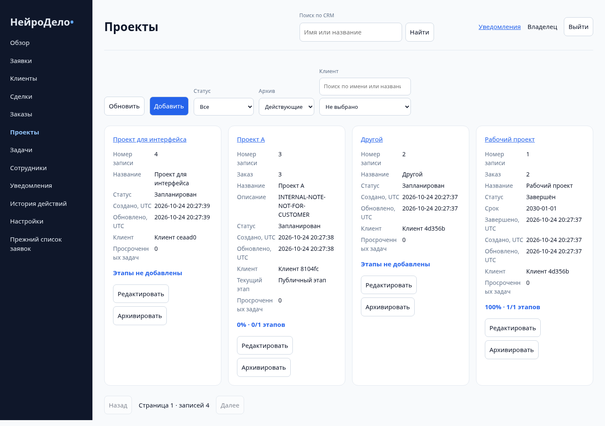
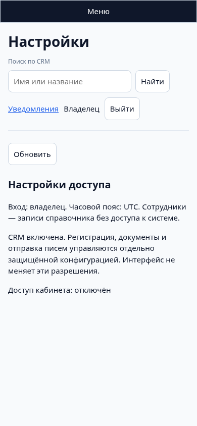
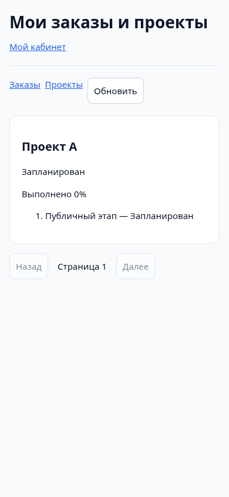

# Stage 5 — проверка интерфейса

Только синтетическая база `neuro_test_*` на loopback, не production. Данные на снимках — тестовые; в пустой реальной БД интерфейс не генерирует клиентов, KPI или события.

Playwright/Chromium: owner login → dashboard (6 KPI) → clients → создание клиента через форму → проверка реального обновления списка. Подмена ответа сохранения на text/html не вызывает ложный успех: модальная форма и введённый черновик сохраняются. При остановленном реальном POST пользователь меняет имя: ответ сохраняет отправленный снимок, а новые правки остаются в открытой форме с обновлённой версией. Ответ 401 переводит к повторному owner login и возвращает тот же черновик после успешного входа. Также автоматически проверено, что у всех полей формы есть связанные labels.

Все основные owner sections dashboard/customers/deals/orders/projects/tasks/employees/notifications/activity/settings открыты на 1440×1000 и 390×844; проверены отсутствие browser pageerror и горизонтального переполнения. Заявки сохраняют существующий старый CRM editor; новый workspace открывает их detail, профиль клиента связывает lead отдельным действием.

Клиентский portal открыт в mobile Chromium с настоящей Stage 4 authenticated session, проверены свой проект/этап и отсутствие внутренней заметки в DOM. Перед этим проверены password login и server-side IDOR по чужому заказу.

Доступность: native buttons/links/forms/dialog, labels, status live regions, visible focus, keyboard editing как альтернатива drag; ручной экспертный screen-reader/axe-аудит не выполнялся. Это не утверждение полной WCAG-сертификации. Браузерные тесты не покрывают каждую последовательность drag-and-drop и все ошибки сети: server-side состояния/переходы/конверсии/конфликты отдельно проверены HTTP integration tests.
