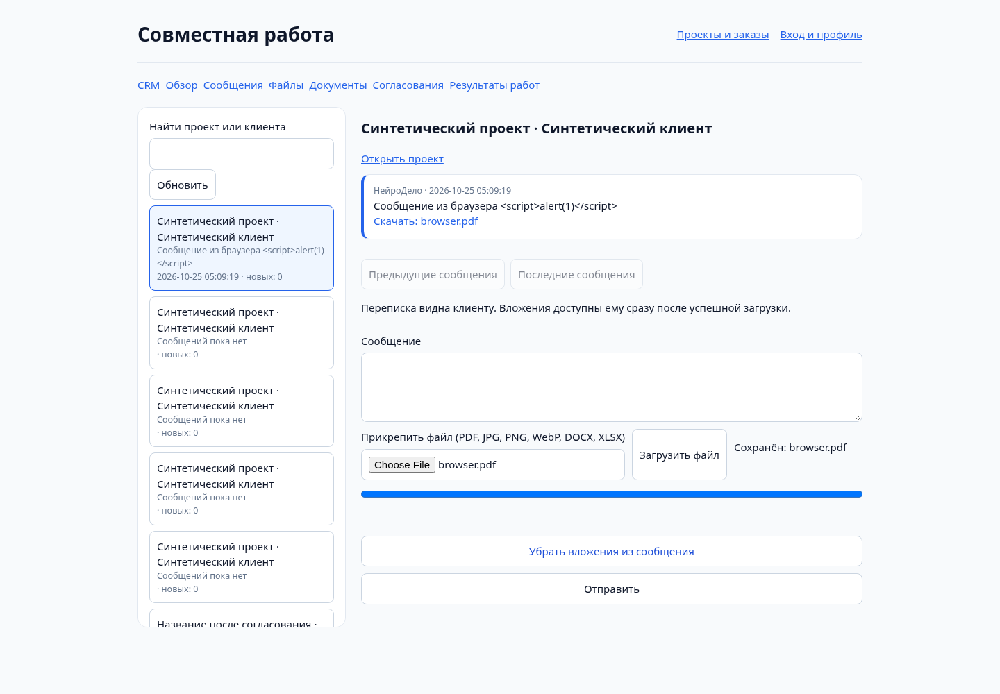
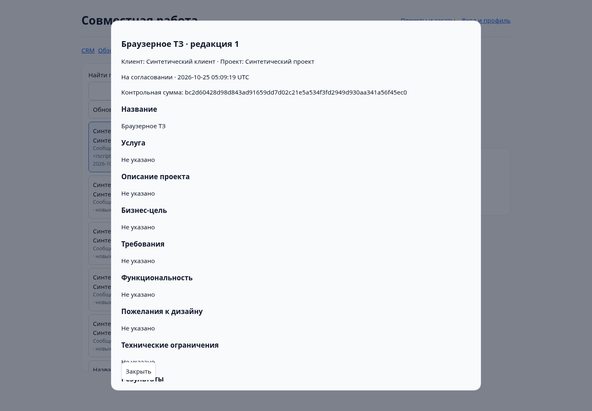
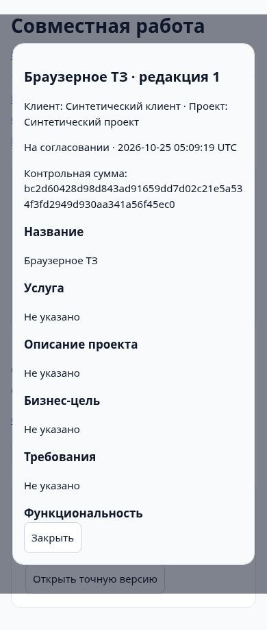
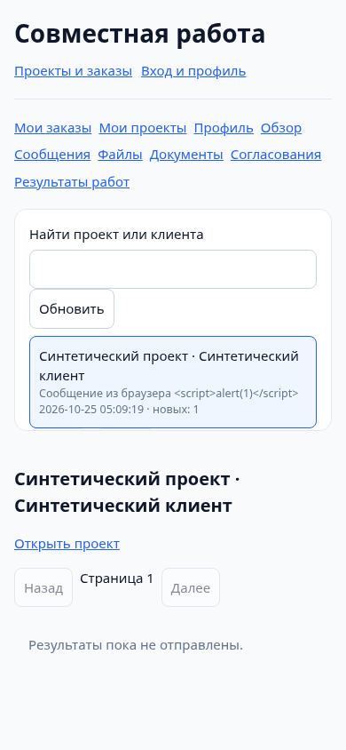

# Stage 6 — браузерная проверка

Все снимки и records — synthetic loopback test database, не production. Никаких demo conversations или seed customers в приложении не создаётся.

Проверен реальный HTTP/browser flow: owner session → message composer → multipart PDF upload → private persisted metadata → message with attachment → document draft → ready → submit → customer session → exact version review → approval. В owner/client contexts используются настоящие существующие session/CSRF механизмы. Desktop 1440×1000, mobile 390×844, Chromium/Playwright.

Ссылка «Проект» открывает точную customer-scoped карточку в существующем кабинете; list navigation сохранена. Dashboard использует реальные статусы, сроки и прогресс.

Customer views overview/messages/files/documents/approvals/deliverables открыты на mobile; проверено отсутствие horizontal overflow и browser pageerror. Stored script text не создаёт script nodes. Подмена message POST ответа на HTML не вызывает успеха и сохраняет textarea; после удаления подмены повторный send корректно сохраняет сообщение.

При задержанном реальном save POST close/Escape не закрывают modal и не теряют draft; mutation controls заблокированы до подтверждённого результата.

Отложенный ответ file picker прежнего проекта после переключения не открывает устаревший editor; новый документ сохраняется именно в выбранном проекте. Отправка сообщения первого проекта, завершившаяся после перехода ко второму клиенту, не меняет второй черновик/вложения; оба сообщения сохраняются в своих проектах.

Документный modal показывает точную редакцию/checksum и structured sections, варианты согласования доступны лишь для current pending review. Решение требует native confirmation; запрос доработки — комментария. Focus переносится к заголовку точной версии, Close доступен в modal. Upload показывает реальные XHR byte progress, filename и size, не таймерную имитацию.

Ограничения проверки: это не экспертный screen-reader/axe/WCAG audit; реальная SpaceWeb UI/permissions, медленные мобильные сети и масштабный multi-worker load test не проверялись. Concurrent HTTP quota requests выполнялись к loopback PHP server; он не заменяет нагрузочный тест нескольких production PHP workers. Транзакционные locks/unique/version checks дополнительно проверены lifecycle/regression сценариями. Customer changes/owner resubmission/file failures проверены HTTP integration tests, не каждая ветвь сценария повторена в browser.
