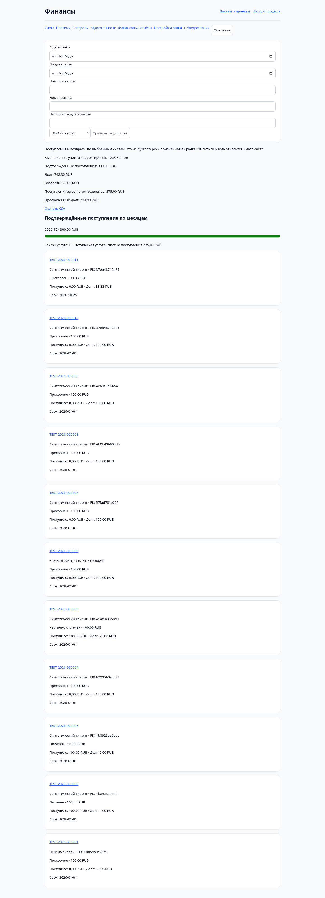
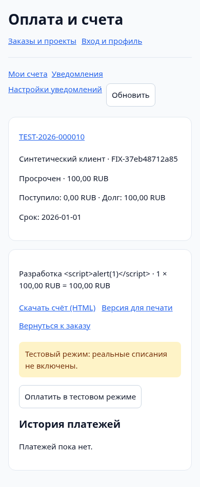
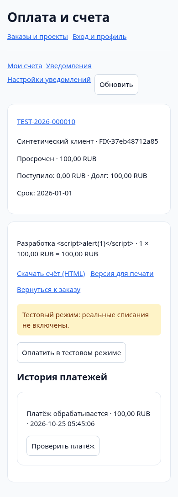
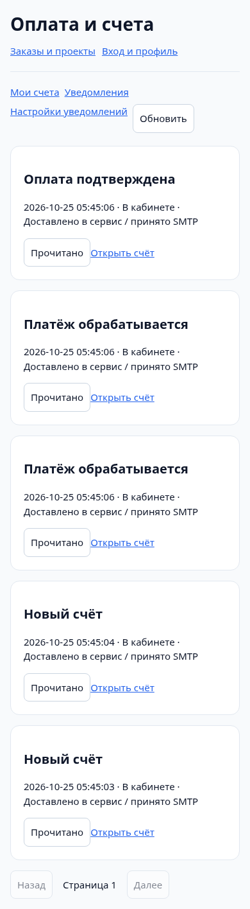

# Stage 7 — проверка интерфейса

Проверка выполнена в Chromium/Playwright с реальным HTTP/PHP/MySQL loopback fixture. Все records/адреса/credentials синтетические; production не использовался. Owner desktop 1440×1000, customer mobile 390×844.

Проверены:

- Открытие owner invoice detail; создание нового draft через существующие customer/order pickers, сохранение и выставление.
- HTML вместо JSON при корректировке не вызывает success; причина/сумма остаются в форме.
- Owner financial report и chart empty state на реальных данных БД.
- Customer scoped invoice, printable/downloadable HTML, явная надпись test mode, pending до проверки, paid после authoritative fixture GET.
- Mobile notifications, отсутствие горизонтального overflow на invoice/pending/notifications; отсутствие browser pageerror и inline stored script execution.
- Реальные payment redirects во внешний sandbox не выполнялись; кнопка не представляет доступную production оплату.

Native confirm применяется к issue/cancel/adjust/refund/pay; формы имеют labels, status area aria-live, navigation semantic. Это не экспертный screen-reader/WCAG audit, не тест iOS/Safari и не проверка SpaceWeb/реального эквайринга. Документ — print-friendly HTML; PDF renderer не добавлен.
