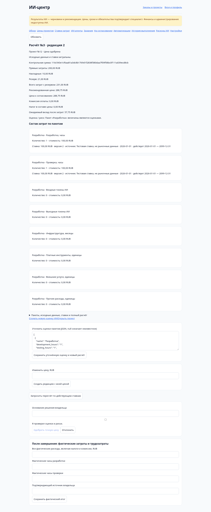
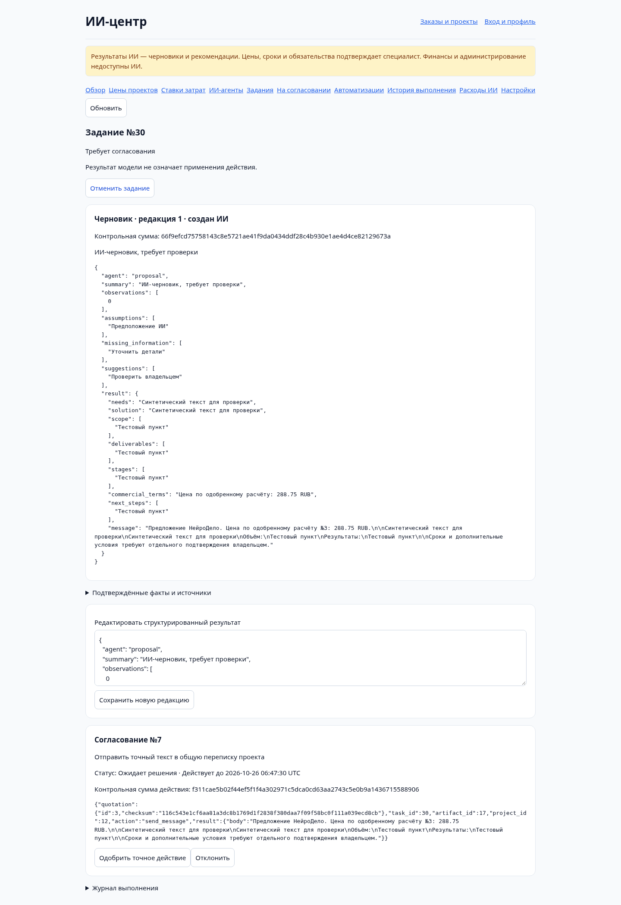
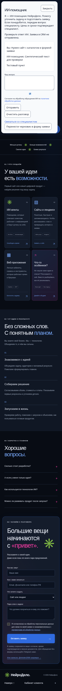

# Stage 8 — UI evidence

Все screenshots/data — synthetic loopback fixtures. Не production, не настоящий Nodul/model API и не реальные ставки.

Chromium/Playwright: owner 1440×1000, public assistant mobile 390×844. Проверены реальные HTTP/PHP/MySQL flows:

- Полный cost breakdown и owner reason/estimate acceptance → точное price approval.
- Proposal task run → validated artifact → owner approval → separately apply → один customer-visible message по одобренной цене.
- Agent registry/control center, отсутствие pageerror/desktop overflow.
- Публичный launcher/disclosure, consent default unchecked, реальная chat API/mock inference, mobile dialog без horizontal overflow.
- Transfer summary в существующую форму заявки не отправляет lead; исходный form consent остаётся unchecked.

Native confirmations и semantic labels/aria-live используются без inline handlers/CSP exceptions. Это не экспертный WCAG/screen-reader audit, не cross-browser/load test и не proof of live AI accuracy. Не каждая отрицательная ветвь повторена в browser — они покрываются HTTP/DB/security tests. Live provider/scheduler на SpaceWeb не проверялись.
